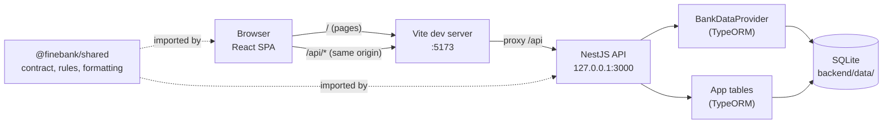
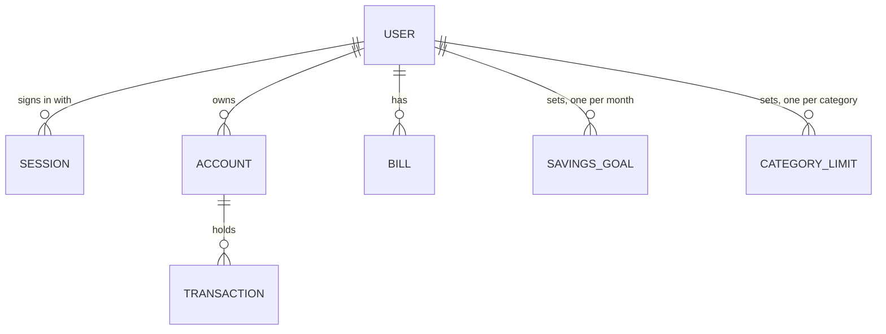

# Architecture

Finebank is a personal finance dashboard: a React single-page app, a NestJS API and an SQLite database in one npm workspace repo. Local only, no deployment. This document describes the system as it is. Every rule here links to the decision (`#N`, `docs/decisions.md`) that set it, and the decision wins where the two differ.

A task that changes a module boundary, an endpoint, a guard, a table or a rule in this file updates this file in the same commit.

## Constraints and non-goals

| Constraint | Consequence |
|------------|-------------|
| Local only, one machine, no deployment | No hosting, scaling, TLS or secrets management in scope |
| Development mode is the only supported runtime | The Vite dev server is part of the system (see Runtime) |
| Desktop only, 1280px minimum width, designed at 1440x1024 (#4, #5, #94) | No mobile or tablet layout |
| Demo data, copied per user on sign-up (#78) | No bank integration; the provider boundary keeps one possible |
| No email verification (#15) | Handled by the Google takeover rule (#104) |
| Email is read-only after sign-up (#33) | The write guard can identify a tab's user by email (#119) |
| One user at a time per browser session | All tabs share one session cookie; stale tabs are handled by the write guard |

## System overview

- The browser only talks to `http://localhost:5173`. Vite proxies `/api` to the backend, so the app has one origin: no CORS, and the session cookie is first-party (#73).
- The backend listens on loopback only (`127.0.0.1:3000`), so nothing outside the machine can reach it, and the test-only clock route is never on the network.
- ESM everywhere. Versions are pinned exactly in the `package.json` files (#79).

## Runtime

The only supported way to run the app is development mode: the Vite dev server serves the SPA and proxies `/api`, the NestJS API runs as one process on loopback.

This matters for security, because three properties depend on the single origin the proxy creates: the first-party session cookie, SameSite=Lax, and the Origin and Host fallback of the CSRF check. A built frontend bundle (`npm run build`) is a type and build check only; nothing serves it.

A production-like mode is out of scope. If it is ever added, the API must serve the built SPA from the same origin (or an equivalent reverse proxy), so that the three properties above still hold, and this section must be rewritten before that change is built.

## Repository layout

| Folder | What it holds |
|--------|---------------|
| `shared/` | `@finebank/shared`: the API contract (`src/contract/`, Zod schemas, one file per resource), validation rules, money, date and percent formatting (`src/format/`), amount fields parsed to cents (`src/amount-input/`), chart rules (`src/chart/`: axis ticks, goal progress), route paths (`src/routes/`) |
| `backend/` | NestJS API. One module per area: `auth`, `users`, `accounts`, `bank-data`, `transactions`, `bills`, `statistics`, `expenses`, `goals`, `calendar`, `demo`. Shared pieces in `common/` (clock, time zone, error filter); `config/` reads the environment and the data paths. `database/` holds the data source and migrations. `data/` (gitignored) holds the SQLite files and the profile photos: `data/uploads/` in development, `data/uploads-test/` with `NODE_ENV=test` (the e2e run, emptied with its database); each backend test app gets a temporary folder of its own, removed when it closes (task 029) |
| `frontend/` | React SPA. `app/` (providers, routes, pages, shell), `routes/` (the route guards `RequireAuth` and `GuestOnly`, paths, the return target), `api/` (one query module per resource and the typed client), `components/` (one folder per component, named from `docs/figma/components.md`), `assets/` (the logo, icons by code name, brand logos), `styles/` (`tokens.css` from `docs/figma/tokens.md`, `global.css`, and `cardHeader.module.css`, the Goals cards' shared title) |
| `e2e/` | Playwright tests on the real stack, fixed clock and time zone |
| `docs/` | Spec, decisions, Figma exports and tokens, metrics, this file |

## The API contract

REST and JSON under `/api` (#74). Each endpoint exists once, as a contract entry in `shared/src/contract/` (the Google sign-in redirects are path constants there, see Endpoints): method, path, request and response Zod schemas, and its body's encoding. Types come from `z.infer`; there is no code generation.

- **One multipart endpoint:** `PATCH /profile` ("Save changes", #76, #127) takes `multipart/form-data`, each field a text part (`encoding: 'multipart'` on its entry, read by the client and the backend), and one optional file part, `photo` (task 029) (`filePart: 'photo'` on the entry), sent under the fixed file name `photo`. Any other encoding answers 415. The request schema checks the text parts and the photo together, the photo by the shared `photoSchema` (#74).
- **One file answer:** `GET /profile/photo` answers the stored photo's bytes with their stored type, not JSON (`responseEncoding: 'file'` on its entry): the frontend puts its address, the contract's path with `?v=<photoUpdatedAt>`, in an `` and never reads it through the client (task 029). The profile and the session user carry `photoUpdatedAt` only when a photo is stored. The profile also carries `hasPassword` (task 030): false for a Google-only user (#2), whose Security tab shows the phone alone.
- The backend passes the shared schemas to Nest's `schema` option, validated by a global `StandardSchemaValidationPipe`. Unknown keys are dropped, so a request cannot set a field the contract does not name.
- The frontend calls the API only through the typed client in `frontend/src/api/client.ts`, which takes a contract entry; the exceptions are a full-page navigation to Google sign-in and the photo's address in an ``. Forms use the same schemas through `zodResolver`, so the form and the API check the same rules.
- **Money** is always integer cents with a currency: `{ "cents": 2505600, "currency": "USD" }`. Every amount is calculated in the backend; the frontend only formats it (#11, #96).
- **Time:** timestamps are ISO strings in UTC; plain dates are `YYYY-MM-DD`; months are `YYYY-MM` (one shared rule).
- **Errors** have one shape, `{ message, fieldErrors? }` (#74, #97).
- **Paging** is by cursor, 10 rows, ordered by time then ID, so a new row between pages cannot duplicate or skip one (#27, task 020).

### Request pipeline

Every `/api` request passes these stages in this order. The order is part of the security model: a new middleware, guard or pipe is placed in this list explicitly.

1. **Cache middleware:** `Cache-Control: no-store` on every response, errors and redirects included.
2. **CSRF check:** a cross-site write answers 403 before anything else runs.
3. **Session guard:** no valid session answers 401, except the `@Public()` routes (sign up, login, logout, Google sign-in, the test routes).
4. **Write guard** (a step of the session guard, the one global guard): for any method other than GET, HEAD and OPTIONS on a route behind the session guard, a missing or invalid `X-Expected-User` answers 400, another user's answers 409.
5. **Multipart body (one route, `PATCH /profile`):** an interceptor, so only after the guards: another encoding answers 415; multer reads the text parts and the one file part `photo` through `FileInterceptor` with tight limits (one file of at most 2,097,152 bytes held in memory, at most 10 parts and fields, 1 KB per value, 100-byte names). A photo past 2 MB answers the photo rule's 400 under `photo`; a file under another name, a second file, another limit or a malformed body answers 400. The file goes into the body as a `Blob` for the schema. Nothing of the body is read before the guards, and nothing reaches the disk before every check (tasks 028, 029).
6. **Validation:** the shared schema validates the request and drops unknown keys (400 with field errors); on the routes that need the user's day (`@TimeZone()`), the time zone header is parsed (400 when missing or invalid).
7. **Handler:** the user comes only from the session; ownership and the read or write are one query.
8. **Exception filter:** wraps all of the above and answers in the shared error shape. On `PATCH /profile`, a guard's 401 or 409 first reads and drops the unread body up to the largest browser save (never parsed or kept; a larger body is cut off), so the answer reaches the browser through the dev server's proxy, which closes the connection after each answer (#131).

### Endpoints

The contract entries in `shared/src/contract/` are the source of truth. This table is an index only.

| Area | Endpoints |
|------|-----------|
| Auth | `POST /auth/signup`, `POST /auth/login`, `POST /auth/logout`, `GET /auth/me`, `PUT /auth/password` (JSON `{ currentPassword, newPassword }`, 204 with no body; behind the session guard and the write guard, task 030) |
| Accounts | `GET /accounts`, `GET /accounts/:accountId`, `PATCH /accounts/:accountId`, `GET /accounts/:accountId/transactions` |
| Transactions | `GET /transactions/recent`, `GET /transactions?tab=&cursor=` |
| Bills | `GET /bills/upcoming` |
| Statistics | `GET /statistics/weekly-comparison` |
| Expenses | `GET /expenses/breakdown`, `GET /expenses/monthly-comparison` |
| Goals | `GET /savings-goals/current`, `GET /savings-goals/months`, `GET /savings-goals?month=`, `PUT /savings-goals`, `GET /category-limits`, `PUT /category-limits`, `GET /saving-summary?month=` |
| Profile | `GET /profile`, `PATCH /profile` (multipart, the optional `photo` file part), `GET /profile/photo` (a file) |
| Calendar | `GET /calendar/today` |
| Test only | `GET /test/clock`, `PUT /test/clock`, registered only with `NODE_ENV=test` |

Outside the contract, because they are page navigations that answer with redirects, not JSON: Google sign-in's `GET /auth/google` and `GET /auth/google/callback` (`googleSignIn` in `shared/src/contract/auth.ts`, task 012), and with `NODE_ENV=test` only, the fake Google page `GET` and `POST /test/google/authorize` (#102).

## Data

SQLite through better-sqlite3 and TypeORM (#79). Schema changes only through migrations, listed by class in `backend/src/database/migrations/index.ts`; `synchronize` is off everywhere, and the backend tests apply the same migrations to their in-memory databases.

- **Money columns are `integer` cents**, never decimal or float, with `CHECK` constraints on their sign: a goal's target and a category limit above 0; a transaction's and a bill's amount and a goal's present amount at least 0.
- **"Nothing" is no row**, never a NULL amount (#85).
- **One row per subject** is held by unique constraints: one savings goal per user and month, one limit per user and category. Writes are single-statement upserts on those keys.
- **A username is unique** by the `users.username` unique index: a profile save is one `UPDATE` of the session user's row, and the index's refusal is the 409 "This username is already taken", never a read before the write (#62, task 028).

### Data model

- `USER` holds the email (unique, read-only, #33), the full name, the username (unique) and the password hash, the phone (task 028): `phone_country_code` (default `+1`, a `CHECK` on `+` and 1 to 3 digits) and `phone_number` (digits only, empty for none, a `CHECK` of at most 15 digits), and the photo (#76, task 029): `photo_path` (the file's name in the uploads folder only, never a path), `photo_mime_type` and `photo_updated_at` (the `Clock`'s time), all null without a photo; `CHECK`s keep all three set or all null, and the name a lowercase UUID v4 with `.jpg` for `image/jpeg` or `.png` for `image/png`, nothing else.
- **The photo file and its row stay consistent** (`UsersService.updateProfile`, the folder only through `PhotoStore`): (1) every check passes first; (2) the file is written under a new `randomUUID()` name, never over an existing file (a disk error: the partial file removed, the row unchanged, 500); (3) one `UPDATE users` with the text and photo columns, its `WHERE` the session user's ID and the photo name read just before it; when another save changed the row in between it touches nothing, and the name is read again and the update repeated, at most 5 tries in all, then a 500 (two saves at once: the last wins, no file left); a failed update (the username taken, a database error) removes the new file and keeps the old file and row; (4) only after the row is stored, the replaced file is removed, and a failure there is logged and keeps the 200.
- Every row belongs to one user, directly or through its account. No query reads across users.
- `ACCOUNT` and `TRANSACTION` sit behind the bank data boundary below; the other tables belong to the app.
- Sessions store only the hash of the token. An expired session is deleted when it is next read; sessions never read again stay in the table (accepted, local only).

### The bank data boundary

Account and transaction data sit behind a `BankDataProvider` interface (#77), so a real bank API could later replace only the provider:

- The provider returns raw data only (full account numbers, opening balances, transactions), always scoped to a user. Its one implementation is `TypeOrmBankDataProvider`.
- Every calculation lives in app services over provider data: balances (#57), Total Balance (#17), the charts (#20, #29, #59), Expenses Breakdown (#21, #61).
- **`VisibleTransactions`** is the only way app code reads transactions. It hides entries dated after today in the user's time zone (#53). A source guard test fails if any other code calls the provider's `listTransactions`.
- **`maskAccountNumber`** is the only code outside `bank-data/` and `demo/` that reads a full account number (#25). Responses carry only `**** **** **** 2598`. A source guard test enforces it.
- **Known weakness:** the bank data module still exports the provider itself, so the boundary rests on the source guard tests, which scan text. The stronger form would be module visibility: export only `VisibleTransactions` and the masking, so no other module can inject the provider. The app does not have it; the source guards hold the boundary.

Profile, sessions, bills, savings goals and category limits are the app's own tables, read directly by their services.

### Demo data

`docs/spec/demo-data.md` is turned into `backend/src/demo/demo-dataset.json` by a one-off script (#78). On sign-up the seeder copies it into the new user's rows inside the same transaction as the user insert: 5 accounts, 3,411 transactions, 14 bills, 84 savings goals and 6 category limits. If seeding fails, sign-up fails and nothing is kept.

## Security model

| Concern | How it is handled |
|---------|-------------------|
| Passwords | scrypt from `node:crypto`, cost stored with each hash; the hash is computed before the database transaction (#75). The password change (task 030, #34): the user from the session only; the current password verified against the session user's stored hash outside any transaction (a Google-only user against the dummy hash, refused alike, #2), the new one hashed only after a match, also outside it; then one transaction: an `UPDATE` keyed on the user's ID and the hash just verified (compare and set, so a change or a Google takeover in between, #104, stores nothing and answers the wrong-password 400) and the delete of the user's other sessions (#129 a). The passwords are never logged, echoed in a body or an error, put in a query or stored but as the hash |
| Sessions | A random 256-bit token in the `finebank_session` cookie (httpOnly, SameSite=Lax, Path=/api); the database stores only its SHA-256 hash. Fixed expiry: 30 days, or a browser-session cookie without "Keep me signed in" (#75). A password change keeps the current session (its row, token, cookie and expiry untouched) and deletes the user's other sessions in the transaction that stores the new hash: another browser is signed out at its next request (401, Login), with no message (#34, #129 a), as a Google takeover ends a user's sessions (#104) |
| Who the user is | A global session guard protects every route except the `@Public()` ones (sign up, login, logout, Google sign-in, the test routes). Handlers get the user only from the session (`@CurrentUser()`); no request parameter selects a user (#39, #46) |
| CSRF | SameSite=Lax plus Nest's built-in CSRF protection (Fetch Metadata, Origin and Host fallback): a cross-site write gets 403 before any route runs (#75) |
| Stale tabs | The write guard (#119), a step of the session guard: every write behind the session guard (not GET, HEAD or OPTIONS) carries `X-Expected-User`, the email of the user the tab shows. The guard parses it with the shared email rule and compares it with the session user's stored email: missing or invalid 400, another user 409, before anything is read or written. Deny by default, so a new write endpoint is covered without opting in. It relies on email being read-only (#33); if email ever becomes editable, the guard must compare a stable user ID instead |
| IDs from the URL | One strict rule, `^[1-9][0-9]*$` within the safe integer range, in the backend and the frontend route. Another user's ID, an unknown ID and a malformed ID all answer the same `404 {"message":"Account not found"}`, so IDs cannot be probed. Ownership and the read or update are one query with the user and the ID in the `WHERE` (task 021, task 022) |
| Caching | One middleware sets `Cache-Control: no-store` on every `/api` response, errors and redirects included (task 017). A test compares it with every registered route |
| Errors | The global exception filter answers in the shared error shape and never echoes database values or internal details |
| Logging | Unexpected errors are logged with their message and stack only, never query parameters or row values, so emails, names and password hashes never reach a log (task 007 review) |
| Google sign-in | Authorization code flow with PKCE and a state cookie (`finebank_google_signin`), `email_verified` required; the user is matched by lowercased email. A takeover of an existing password account removes the password and ends its sessions (#104). A fake Google client is used with `NODE_ENV=test` (#75, #102) |
| Redirects | `returnTo` accepts relative in-app paths only (one shared rule for the frontend and the backend) |
| Dev server files | The Vite dev server never serves `backend/data/` (the SQLite files and the photos): `server.fs.deny` in `frontend/vite.config.ts` adds `**/backend/data/**` to Vite's own entries, kept as they are (task 029) |
| Uploads (task 029) | The profile photo, #76 and #128 as built: parsed only after the guards; held in memory, at most 2,097,152 bytes; JPEG or PNG by its first bytes only (the shared `photoSchema`; a file whose bytes cannot be read is refused as an empty one is), never the file name or the declared type, which are never stored or logged; stored as uploaded (metadata such as EXIF location kept, #128 b) under a server-made `<uuid>.jpg` or `.png`, the column's `CHECK` on that shape and the store resolving only that shape inside the uploads folder. `GET /profile/photo` serves only the session user's photo (no parameter, `?v=` ignored) with its stored `Content-Type`, `X-Content-Type-Options: nosniff`, `Content-Security-Policy: default-src 'none'; sandbox` and `Cross-Origin-Resource-Policy: same-origin`, so a polyglot is never read as a page, runs nothing when opened directly and loads on no other site; one 404 body without a photo or with its file missing. **Condition (#128):** if photos are ever shown to other users, metadata stripping must be added first |

## Time and time zones

- The backend reads "now" only from the injected `Clock` (#80). With `NODE_ENV=test` it is a fixed clock that the e2e tests set through `/api/test/clock`.
- The user's zone comes only from the `X-Time-Zone` header, which the API client sends on every request (#54). On the routes that read it (`@TimeZone()`), a missing or invalid zone is a 400.
- "Today", day starts, week and month edges are computed by the shared helpers in `backend/src/common/time-zone/`, which handle daylight saving (a Belgrade week can be 169 hours). No code adds 24-hour steps to find a day in a zone; only the zone-free plain-date arithmetic in UTC steps by days.
- Plain dates are compared as `YYYY-MM-DD` strings, never bound as `Date` objects (a `Date` binds as `YYYY-MM-DD HH:MM:SS.SSS` and drops the row due today; task 008 review).

## Accepted constraints

| Constraint | Why it is accepted |
|------------|--------------------|
| The SQLite driver is synchronous, so a query blocks the API process | One user on one machine; queries are small |
| One API process, no horizontal scaling | Local only |
| Expired sessions are cleaned up only when read | A few stale rows locally; no privacy impact, the tokens are hashed |
| E2E tests run one at a time | One backend and one test clock are shared by every test |
| Every sign-up copies about 3,500 rows | One transaction, well under a second locally |
| A process that dies between a photo's file write and its row update, or a failed removal of a replaced photo, leaves an unused file in the uploads folder (task 029) | No row names it and nothing serves it; no sweep is built |
| The photo is fetched again on every page load (`no-store` on every `/api` answer, task 017) | At most 2 MB, local; `?v=` changes the address after a save so a mounted `` asks again |
| A stored photo keeps its metadata (EXIF location included, #128 b) | It is served only to its owner; stripping comes first if photos are ever shown to others |
| No limit, lockout, delay or captcha on wrong passwords: login and the password change take any number of attempts (task 030) | Brute-force protection is not part of the app (#14). Each attempt costs one scrypt verification (N = 2^17, about 128 MB); the change also needs a valid session, a same-site request and the user's email in `X-Expected-User`. Any such protection would have to cover both |

## Frontend

- **Routing:** React Router 8 in data mode. App pages sit inside `AppShell` (sidebar, header, content area); auth pages inside `AuthLayout`. Unknown URLs and a bad account ID follow #39 and task 021.
- **Data:** TanStack Query, one query per resource. Pages that show the same data share one query (Overview and Balances share `['accounts']`; Overview and Bills share `['bills', 'upcoming']`; Overview and Expenses share `['expenses', 'breakdown']`), so two screens cannot disagree. Every cached query is cleared when a session starts or ends, and when another tab signs in a different user.
- **Writes:** one shared helper sends the write-guard header and drops an answer that arrives after the session changed. After a save, only the queries that show a changed value are updated or reset.
- **States:** every widget goes through `DataState` (#6): a skeleton while loading, "Something went wrong." with Retry on a first failure, the data kept on a failed background refetch (#89), and focus kept in the widget after Retry (#114). Goals' Savings Goal and Saving Summary cards wait for the month list through one `useGatedQuery`, so their skeleton and error state cover both reads.
- **Styling:** CSS Modules with design tokens only; Stylelint rejects raw colors, sizes, spacing, radii and shadows. Components are named from `docs/figma/components.md`.
- **Layout:** every page is full width with a 280px sidebar and a 1280px minimum including the scrollbar (#94, #101). App pages keep a stable scrollbar gutter (#100), so the scroll lock of an open popup or dropdown adds no margin there: one rule in the shared app-shell styles cancels it, and nothing moves as one opens or closes (#134 b). Charts are hand-drawn SVG, no chart library; Overview's Statistics and the Expenses chart are two descriptions of one `ComparisonChartCard`. The backend sends domain values only (amounts in cents, the axis top and steps, progress), never pixel positions; the frontend maps them to the layout and calculates no amounts (#55, #91, #113). This keeps the API independent of one screen size. Each chart has a visually hidden table for screen readers (#113 b); the goal gauge is a `meter` with its value as text.
- **Accessibility:** a teal `:focus-visible` ring on buttons and links (#87), text fields show focus with their darker border, keyboard behaviour on tabs, dropdowns, popups and Load More, and live regions where content changes in place.

## Testing

Each acceptance criterion is proven once, at the lowest layer that can prove it. The same scenario is never tested in two layers.

| Layer | Tool | What it proves |
|-------|------|----------------|
| `shared` | Vitest | Contract schemas, money and date rules, formatting, axis ticks |
| Backend | Vitest, Supertest, an in-memory SQLite database per test app with every migration applied | Calculations, user scoping, the request pipeline, error answers, time zone edges, source guards (provider reads, account numbers, no system time) |
| Frontend | Vitest, Testing Library, MSW | Components, UI states, forms, keyboard, cache behaviour; that every class a file takes from a CSS module has a selector there (`test/styles/css-module-classes.test.ts`, since Vitest's CSS-module stub answers any name) |
| E2E | Playwright on Chromium, 1440x1024, fixed clock `2026-10-22T10:00Z`, Europe/Belgrade | Only the real flows through the whole stack: per task one happy path and at most one error or scoping flow, plus one 1280px minimum-width check per page. The browser hides scrollbars, except in `scroll-lock.spec.ts`, which draws a classic 15 px scrollbar to check that no popup or dropdown moves the page (#135) |

Layout is checked outside the test suites: `/next-task` renders each screen with Playwright MCP and compares it with the PNGs in `docs/figma/`. Tasks that change security, user scoping, money or dates also prove their key tests by breaking the code on purpose, 3 to 5 breaks per task (`/next-task` step 6), each restored and checked by the hashes of `git diff HEAD` and `git status --short`.

## How the project is built

Spec first (`docs/spec/`), every gap as a numbered decision (`docs/decisions.md`), then one task per session through `/next-task`, with a human gate on anything visual, security-related or architectural. See `README.md` for the process and `CLAUDE.md` for the rules every session reads.
